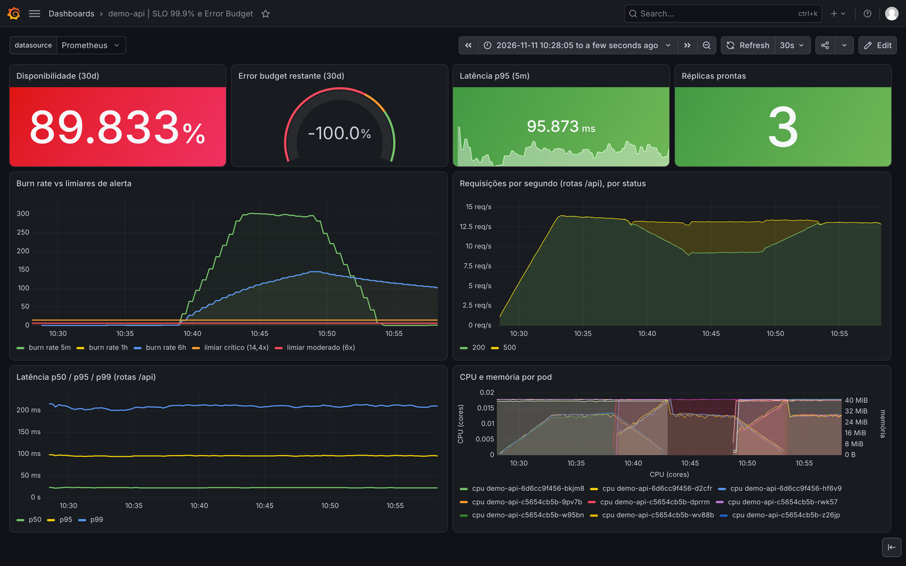
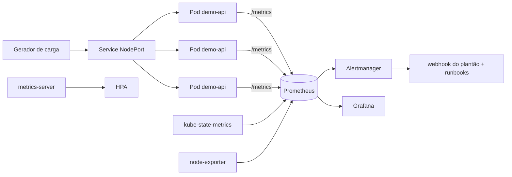
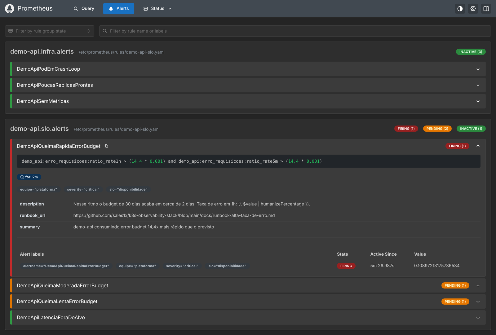
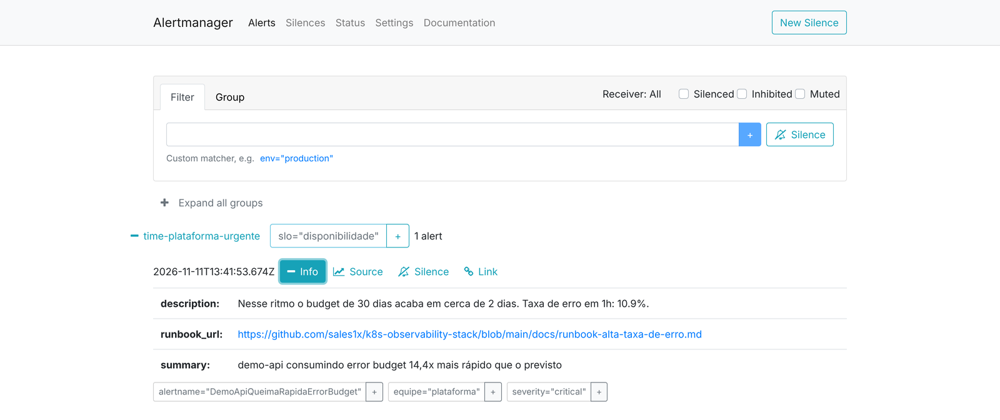
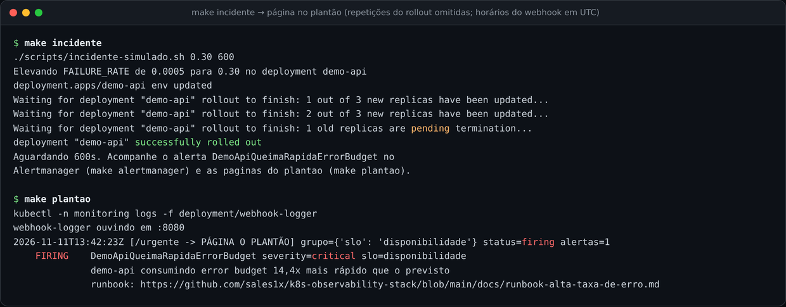

# k8s-observability-stack

Stack de observabilidade e confiabilidade rodando em Kubernetes local (kind), com SLOs
definidos formalmente, alertas por burn rate de error budget, dashboards de Grafana e
runbooks para cada alerta que aciona o plantão.

O objetivo do laboratório não é monitorar CPU: é responder à pergunta que importa em SRE,
"o serviço está bom o suficiente para o usuário?", e alertar apenas quando a resposta
começa a ficar negativa rápido demais.




## Arquitetura



## O que tem aqui

- Cluster kind de 3 nós definido em `kind/cluster.yaml`, com metrics-server para o HPA
  funcionar (o kind não traz um)
- Aplicação FastAPI instrumentada com métricas RED (`app/`), com container rodando como
  usuário não-root, filesystem somente leitura e capabilities removidas
- `kube-prometheus-stack` instalado via Helm, em versão fixada, com values próprios (`monitoring/`)
- SLO de disponibilidade (99,9%) e de latência (95% abaixo de 250ms), documentados em `docs/slo.md`
- Recording rules e alertas multi-janela / multi-burn-rate em `monitoring/prometheus-rules-slo.yaml`
- Testes automatizados dos alertas com `promtool test rules` (`monitoring/tests/`): incidente
  dispara, baseline saudável não dispara, probes não diluem o SLI
- Dashboard de SLO e error budget em `monitoring/grafana-dashboard-slo.json`
- Runbooks acionáveis, linkados na anotação `runbook_url` de cada alerta que aciona o plantão
- Receptor de webhooks (`monitoring/webhook-logger.yaml`) que faz o papel do plantão e mostra
  cada notificação do Alertmanager
- Script de incidente simulado para provar que o alerta dispara de verdade
- Pipeline de CI que valida manifests (kubeconform), scripts (shellcheck), regras (promtool,
  sintaxe e testes) e a configuração do Alertmanager (amtool), e sobe um cluster kind efêmero
  para um teste end-to-end com HPA

## Pré-requisitos

Docker, kind, kubectl, helm e make. Para o `make lint`, também Python 3 com PyYAML.

## Subindo o ambiente

```bash
make up
```

O alvo executa, em ordem: criação do cluster, build da imagem, carga da imagem no kind,
instalação do metrics-server e do stack de monitoramento, deploy da aplicação e publicação
do dashboard. Leva de 5 a 8 minutos na primeira execução.

Depois:

```bash
make carga        # tráfego sintético (30 min)
make grafana      # http://localhost:3000  (admin / admin)
make prometheus   # http://localhost:9090
make alertmanager # http://localhost:9093
make plantao      # notificações que o Alertmanager mandou para o plantão
```

## Validando os alertas

Alerta que nunca disparou não vale nada. Com o `make carga` rodando em um terminal, rode em
outro:

```bash
make incidente
```

O script eleva a taxa de erro da aplicação de 0,05% (o normal, dentro do error budget) para
30%, o que corresponde a um burn rate de 300x sobre um SLO de 99,9%. O que acontece:

- cerca de 1 minuto depois do rollout, o `DemoApiQueimaRapidaErrorBudget` entra em `pending`
  e, 2 minutos depois (`for: 2m`), vai para `firing`;
- o Alertmanager manda a página para o plantão em 30 segundos (`make plantao` mostra a
  notificação, com o link do runbook);
- os alertas de SLO são agrupados por `slo`: a janela de 6x, que dispara mais tarde, entra no
  mesmo grupo de notificação (no PagerDuty, o mesmo incidente) em vez de abrir uma segunda
  página, e a regra de inibição suprime o warning de queima lenta do mesmo SLO;
- depois de 10 minutos o script restaura a taxa anterior (também se for interrompido com
  Ctrl+C), e o alerta de queima rápida resolve sozinho cerca de 5 minutos depois, quando a
  janela curta deixa de ver o incidente.

Os mesmos cenários rodam no CI como teste automatizado (`monitoring/tests/slo-alertas_test.yaml`).

### Demonstração

Prints de uma execução do laboratório com `make carga` e `make incidente`. No dashboard do topo,
o burn rate de 5 minutos sobe até 300x durante o incidente e volta para perto de zero depois
que o script restaura a taxa de erro.

O alerta de queima rápida em `firing` no Prometheus, com o link do runbook:



O Alertmanager agrupando o alerta pelo SLO e enviando para o receiver do plantão:



O `make incidente` e a notificação que chega ao plantão (`make plantao`):



## Decisões de projeto

**Por que burn rate em vez de alertar em "taxa de erro maior que 1%".** Um limiar fixo em
janela curta gera alarme falso a cada pico isolado, e em janela longa demora horas para
detectar uma queda severa. O modelo de duas janelas simultâneas (uma longa para confirmar
significância, uma curta para o alerta resolver rápido quando o problema acaba) resolve os
dois lados. Os fatores 14,4x, 6x e 3x vêm do SRE Workbook e mapeiam para porcentagem do
budget consumido, e não para um número arbitrário.

**Por que 4xx não conta como erro.** O SLI mede a saúde do serviço. Um cliente enviando
payload inválido não é falha da plataforma, e contabilizar isso faria o time gastar budget
com problema de terceiro.

**Por que as probes ficam fora do SLI.** `/healthz` e `/readyz` são chamadas pelo kubelet,
não pelo usuário, e sempre respondem 200. Somadas ao denominador, diluem a taxa de erro e,
sem tráfego real, fariam o SLI marcar 100% medindo só as probes.

**Por que `maxUnavailable: 0` no rolling update.** Com PDB de `minAvailable: 2` e 3 réplicas,
subir o pod novo antes de derrubar o antigo evita janela de capacidade reduzida durante o deploy.

**Por que promtool no CI.** Erro de sintaxe em PromQL só aparece quando o Prometheus recarrega
a configuração, normalmente em produção. Validar no pull request custa 10 segundos. E os
testes de alerta garantem que uma mudança na regra não faça o alerta parar de disparar
(ou passar a disparar sem incidente) sem ninguém perceber.

## Estrutura

```
app/           aplicação instrumentada + Dockerfile multi-stage
kind/          definição do cluster local
k8s/           Deployment, Service, HPA, PDB, ServiceMonitor
monitoring/    values do Helm, PrometheusRule com os SLOs e testes, dashboard, receptor de webhooks
scripts/       geração de carga, incidente simulado, extratores de regras e da config do Alertmanager
docs/          definição de SLO/SLI, política de error budget, runbooks e prints (img/)
```

## Próximos passos

- Tracing distribuído com OpenTelemetry Collector e Tempo
- Logs centralizados com Loki e correlação trace/log no Grafana
- Regras de SLO geradas a partir de um arquivo declarativo (Sloth ou Pyrra)

## Autor

Luis Fernando Sales da Silva
[github.com/sales1x](https://github.com/sales1x) | saleslf@icloud.com
